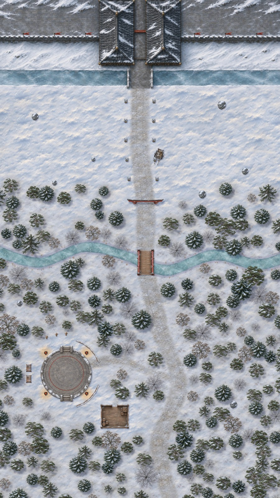

# Winter Fortress — The Forest Approach

A snowbound gatehouse overlooks a frozen moat. From the red torii and footbridge, the forest road branches toward a circular training yard and an open equipment shed.



## Use at the table

Import the [woodland revision](winter-fortress-groves.uvtt) as a Universal VTT scene in puzzle-slop. The file includes the full 2,880 × 5,120 painting on a 72 × 128-square map. The two fortress gates and the shed door are interactive. The artwork follows 1,369 sight-blocking segments and 4,368 nonzero terrain cells. The forest uses independently drawn crowns with consistent lighting, a mix of canopy sizes, and irregular gaps where paths and clearings open up.

The layout comes from puzzle-slop's winter fortress starter. This edition includes the three terrain edits present in the localhost test scene on November 20, 2026. Encounter tokens, fog, drawings and initiative belong to the running game and are outside the UVTT file. See the [3D terrain rendered by puzzle-slop](woodland-3d.webp).

## Reuse the art in another map

Browse the [original catalog](asset-catalog.webp) and the [woodland variants](woodland-canopy-catalog.png). Register the [winter asset pack](source/asset-pack.json) to make all 26 pieces available in the editor and from the terminal. From the project root, run

```sh
bun run assets import-pack examples/winter-fortress/source/asset-pack.json
bun run assets list --tag winter-fortress
bun run assets sheet --tag winter-fortress --out winter-candidates.png
```

Use the visual sheet to choose a piece, then `bun run assets path <id>` to get its PNG. The library record links the piece to its source sheet and generation prompt.

## Rebuild the painting

The [source folder](source/) contains the PNG sheets made with Codex's built-in image generator. The [prompts](source/prompts.json) identify the role of each image. The northern gatehouse was painted against [a cropped reference](source/north-guide.png) spanning rows 0–24 of the original map. Terrain swatches and transparent props cover the rest. [Layout coordinates](source/layout.json) come from the starter's deterministic placement of roads, trees and landmarks.

From this repository's root, run the following commands. Only the example compositor needs Sharp.

```sh
npm ci --prefix examples/winter-fortress/source
node examples/winter-fortress/source/compose.mjs out/winter-fortress.webp
bun run map-art pack examples/winter-fortress/source/geometry.uvtt --art out/winter-fortress.webp --out out/winter-fortress.uvtt --name "Winter Fortress — The Forest Approach (woodland)"
```

To inspect the registration or extract the full-resolution WebP directly from the packaged scene, use the guide command.

```sh
bun run map-art guide examples/winter-fortress/winter-fortress-groves.uvtt --out out/fortress-guide.png --reference out/fortress-art.webp
```

For the optional puzzle-slop 3D treatment, use `node examples/winter-fortress/source/compose.mjs out/winter-fortress-ground.webp --ground-only` to rebuild the registered floor artwork with the painted tree canopies removed. The VTT uses its tree models over that floor and keeps the UVTT painting in 2D.
